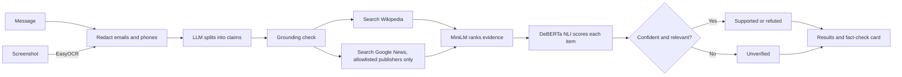

# Claim Checker for Viral Messages

Paste a forwarded message or upload a screenshot. The app splits it into individual claims, checks each one
against Wikipedia and trusted news outlets, and marks it **supported**, **refuted** or **unverified** with a link to
the evidence. It can also produce a shareable fact-check card.

Generative AI mini-project P54 (Track E: ethics, governance and responsible deployment).

**Live app:** [model-card-claim-checker-for-viral-messages.streamlit.app](https://model-card-claim-checker-for-viral-messages.streamlit.app)  
**Demo video:** _add your link_  
**Demo video (2 min):** _add your link_

## Run it locally

You need Python 3.12 or newer, and [Ollama](https://ollama.com) with one small model:

```
ollama pull qwen3:1.7b
pip install -r requirements.txt
copy .env.example .env
python -m streamlit run app.py
```

The first load takes a minute or two while PyTorch imports and the models download. If port 8501 is taken, add
`--server.port 8502`.

To check the core logic without any network or LLM, run `python test_checker.py`.

## Choosing the LLM

The app reads this from `.env`:

| `GROQ_API_KEY` | LLM used | Best for |
| --- | --- | --- |
| empty | Local Ollama (`OLLAMA_MODEL`) | Development; message text stays on your machine, apart from the search terms sent to Wikipedia and Google News |
| set | Groq (`GROQ_MODEL`) | The deployed app, because Ollama can't run on Streamlit Cloud |

Both use the same OpenAI-compatible API, so nothing else changes between them.

## Deploy to Streamlit Community Cloud

1. Push this folder to a public GitHub repo. `.gitignore` already keeps `.env` out.
2. Create an app at [share.streamlit.io](https://share.streamlit.io) with `app.py` as the entry point, and choose
   Python 3.12 under Advanced settings.
3. Under **Secrets**, add your key from [console.groq.com](https://console.groq.com/keys). Secrets are TOML, not `.env`
   format, so every value needs straight double quotes. Copy from
   [.streamlit/secrets.toml.example](.streamlit/secrets.toml.example) to avoid "Invalid format: please enter valid TOML":

   ```toml
   GROQ_API_KEY = "your-key"
   WIKI_USER_AGENT = "ClaimChecker-student-project/1.0 (your GitHub repo URL)"
   ```

4. Under **Sharing**, make the app public, or visitors (including examiners) are sent to a login page.
5. Open the app and run one check before demo day, so that the models are already downloaded.

## How it works



The LLM only splits the message into claims. A separate classifier decides every verdict from retrieved evidence,
so the LLM can't simply make up an answer. If no item is both relevant and confidently scored, the claim stays
unverified. If confident items point both ways, the app warns that sources disagree.

If one source can't be reached, the check carries on with the other and says which one was missed.

| Path | Purpose |
| --- | --- |
| [app.py](app.py) | Streamlit interface |
| [checker.py](checker.py) | The pipeline, with its thresholds and news allowlist at the top |
| [evaluate.py](evaluate.py) | Produces everything in `results/` |
| [test_checker.py](test_checker.py) | Offline self-check |
| [data/messages.json](data/messages.json) | 10 labelled messages, used for tuning |
| [data/heldout.json](data/heldout.json) | 12 labelled claims, not used for tuning |
| [assets/](assets) | Background illustrations |
| [promo/](promo) | Scripts that render the 2-minute demo video |
| [MODEL_CARD.md](MODEL_CARD.md) | Models, sources, limits, safety and licences |

## Syllabus coverage

### Unit I: Foundations

- **Lifecycle:** the diagram above.
- **Generative vs discriminative:** the LLM is generative, so it writes new text and can invent things. DeBERTa is
  discriminative, so it only classifies an (evidence, claim) pair.
- **Prompt techniques:** zero-shot and few-shot claim splitting, compared below and selectable in the app.
- **Probability view:** each claim shows the NLI probability distribution over entailment, neutral and contradiction.

### Unit II: GANs and LLMs

- **Transformer LLM:** Llama 3.3 on Groq, or Qwen3 on Ollama.
- **Fine-tuning vs prompt-based learning:** this project uses prompt-based learning. Few-shot examples raised recall
  from 81% to 100% with no training, data labelling or GPU. Fine-tuning would need a large labelled set of split
  messages, and it would tie the app to one model.
- **Attention:** each result can show a heatmap of DeBERTa's last-layer attention between claim tokens and evidence
  tokens.

### Unit III: GPT, BERT and multimodal

- **GPT-style generator:** the LLM above.
- **BERT family:** DeBERTa v3 for verification, and MiniLM for sentence embeddings.
- **Image modality:** screenshots are read with EasyOCR's vision models.

### Unit IV: Tools and generation

- Built in Python with PyTorch.
- **Image generation:** a fact-check card is generated as a downloadable PNG with Pillow.

### Unit V: Responsible AI

- **Measured hallucination test:** see below.
- **Guardrails:** PII redaction, treating message text as data rather than instructions, a grounding check that
  drops invented claims, an allowlist of news publishers, and defaulting to unverified.
- **Licence and IP note, and model card:** see [MODEL_CARD.md](MODEL_CARD.md).

## Results

These come from `python evaluate.py` using `qwen3:1.7b` on Ollama, on a laptop CPU. Full tables are in
[results/evaluation.md](results/evaluation.md), and the verdicts for all 10 messages are in
[results/verdicts_10_messages.md](results/verdicts_10_messages.md).

**Verdict accuracy, given correct claims: what adding news changed**

| Set | Wikipedia only | Wikipedia and news | Supported/refuted flipped (with news) |
| --- | --- | --- | --- |
| Held-out (12 claims) | 9/12 = 75% | 10/12 = 83% | 2 |
| Tuning (21 claims) | 19/21 = 90% | 21/21 = 100% | 0 |

The thresholds were chosen by looking at the tuning set, so the held-out numbers are the more honest ones, and the
100% shouldn't be read as real-world accuracy. Both sets are small: one claim moves the held-out score by 8 points.
Results also vary between runs, because search results change. An earlier Wikipedia-only run scored 10/12 on the
held-out set with the same verdict logic, so this single comparison is encouraging, not proof.

News fixed the claims Wikipedia couldn't settle, such as the UNESCO anthem hoax and the 5G claim, which both went from
unverified to refuted. It didn't fix either of the held-out flips below.

**Zero-shot vs few-shot claim splitting (10 messages)**

| Prompt | Claims kept | Precision | Recall | Latency per message |
| --- | --- | --- | --- | --- |
| Zero-shot | 18 | 100% | 81% | 8.2s |
| Few-shot | 23 | 96% | 100% | 7.1s |

**Hallucination test: the LLM with no evidence (21 claims)**

The LLM got 18/21 = 86% right and answered 3/21 = 14% confidently and wrongly. It said Gandhi's 1948 assassination
was false, and it "refuted" two claims the test set labels as unverifiable. The pipeline's advantages are showing its
evidence and being able to say "unverified", as well as the higher score on this set.

**Speed:** one end-to-end check of a three-claim message took about 86 seconds on a laptop CPU with a cold start for
the models. Repeated checks are faster because pages and feeds are cached. Rate limiting can add more.

## Failure cases

| Case | Result | Why |
| --- | --- | --- |
| "Cracking your knuckles causes arthritis." | Supported, should be refuted | A Wikipedia sentence calling it an "old wives' tale" still scores as entailment. Other sources do refute it, so the app warns that sources disagree. |
| "The Sun orbits the Earth." | Supported, should be refuted | Decided by the Wikipedia page "Heliocentric orbit". It flipped between runs earlier, depending on search results. |
| "The MMR vaccine is still pushed on your kids." (message 1) | Refuted, citing FactCheck.org | The LLM extracted something that isn't a checkable claim, and the classifier gave it a confident verdict anyway. |
| "Doctors are hiding that vaccines cause autism." (message 1) | Unverified | The LLM kept the framing "doctors are hiding", which changes what is being checked. The plain claim "Vaccines cause autism" is refuted. |
| "Save lives, share now." (message 7) | Extracted as a claim | The small model doesn't always ignore calls to action. It came back unverified, so no harm was done. |

## Limitations

- English only. Breaking news and local rumours can still come back unverified.
- News evidence is the headline only, and it can be years old. Dates are shown, but the model ignores them.
- The news allowlist is the author's judgement, and Google News RSS isn't a documented, supported API.
- The test sets are small and were labelled by the author, so treat these numbers as indicative.
- The results above come from the local Ollama model, while the deployed app uses Groq. Re-run `python evaluate.py`
  with `GROQ_API_KEY` set to get numbers for the deployed model.

## Demo video

The 2-minute demo video is shared separately and is not stored in this repository. It uses real footage of the app,
partly sped up, and says so in its credits. The narration is Kokoro text-to-speech, not a human recording. To re-render it, start the app, then:

```
python promo/record.py WORK/rec SCREENSHOT.png
uv run --no-project --python 3.12 --with pillow --with numpy --with imageio-ffmpeg --with kokoro-onnx ^
    python promo/film.py WORK/rec KOKORO_DIR TRACK.mp3 promo/claim_checker_demo.mp4 WORK/film
```

`KOKORO_DIR` holds `kokoro-v1.0.onnx` and `voices-v1.0.bin`. The music is not in this repo.

## Licence and data

Wikipedia text is CC BY-SA and is shown as short quotes with links. News headlines belong to their publishers and are
shown with attribution and a link. See [MODEL_CARD.md](MODEL_CARD.md) for model licences. The app doesn't store
messages or uploads. With Groq, redacted message text is sent to Groq.
